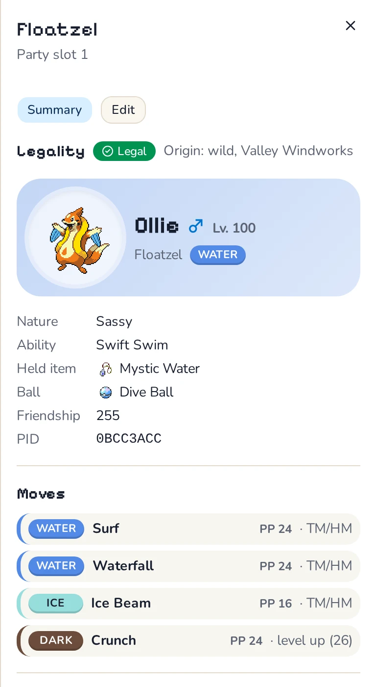
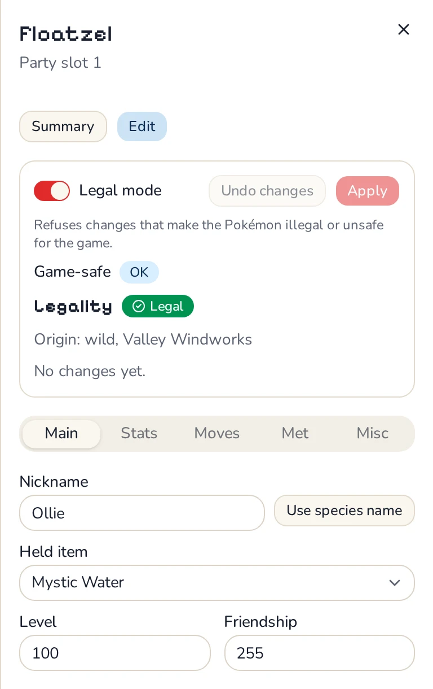

# Verity

<picture>
  <source media="(prefers-color-scheme: dark)" srcset="assets/logo/lockup-dark.svg">
  
</picture>

A legality-aware save editor for the Gen 4 and Gen 5 Pokémon games: Diamond, Pearl, Platinum,
HeartGold, SoulSilver, Black, White, Black 2 and White 2. Every Pokémon is checked against the
rules [PKHeX](https://github.com/kwsch/PKHeX) uses, and the editor refuses changes that would make
one illegal.

**[Open Verity in your browser](https://verity.llamington.workers.dev)**: nothing to install, and
your save never leaves your device. It also runs on the DS itself (see below).

  
  

## Features

- **Legality checks:** origin, moves, IVs and PID, met data and ribbons, with the reason a check
  failed.
- **An editor that stays legal:** levels, moves, IVs and EVs, items, met data, nicknames and
  ribbons, with a live legality preview.
- **Add legal Pokémon:** wild encounters (Synchronize, Cute Charm, the Poké Radar) and Gen 4 eggs,
  generated the way the games do.
- **Mystery Gifts:** deliver Wonder Cards and event gifts as the games do.
- **Bag, Memory Link and keys:** edit every pouch, link a Black or White save into Black 2 or
  White 2, and receive or enable keys.

## Getting your save

Verity opens a raw save (`.sav`) or a DeSmuME save (`.dsv`). Keep a copy of the original.

- **Emulator:** the `.sav` (or `.dsv` for DeSmuME and DraStic) is beside the game or in a saves
  folder. Close the game first, or the emulator may overwrite your edits.
- **TWiLight Menu++ or a flashcart:** the `.sav` is on the SD card, in a saves folder next to the
  game or beside it.
- **Game cartridge:** copy the save off with Checkpoint on a 3DS or GodMode9i on a DSi, and
  restore it with the same tool.

## On the DS

Download `verity.nds` from the [latest release](https://github.com/llamington/verity/releases/latest),
copy it to your SD card and open it from TWiLight Menu++ or a flashcart. It edits the saves on the
SD card directly. On first boot it builds its fonts and sprites from a Gen 4 or 5 game it finds on
the card, so no Nintendo assets are shipped.

## Development

Verity is a Rust core with two front ends:

- **`crates/verity`**: the core (Rust `#![no_std] + alloc`, no I/O, works on byte buffers)
- **`crates/verity-ffi`**: C ABI static library for the DS front end
- **`crates/verity-wasm`**: browser bindings for the web app
- **`crates/verity-rom`**: reads fonts and graphics from the user's own ROM on the DS
- **`crates/datagen`**: compiles the oracle's exports into compact binary data blobs
- **`nds/`**: the DS front end (BlocksDS, C++)
- **`web/`**: the web app (SvelteKit)
- **`tools/pkhex-oracle/`**: reference oracle built on `PKHeX.Core`
- **`tools/emu-harness/`**: headless melonDS runner for automated DS checks

[CONTRIBUTING.md](CONTRIBUTING.md) covers setup, building, tests and commit messages.
[docs/architecture.md](docs/architecture.md) explains how the parts fit together and the design
rules they follow.

## Credits & Licensing

- Licensed under **GPLv3**.
- Logic and legality rules ported from [PKHeX](https://github.com/kwsch/PKHeX) (kwsch and contributors).
- Memory Link research and references adapted from [BW_tool](https://github.com/suloku/BW_tool) (suloku).
- Verity is a fan project, not affiliated with or endorsed by Nintendo, Game Freak or The Pokémon
  Company.
- Screenshots and photos show Pokémon artwork © Nintendo, Game Freak and The Pokémon Company. That
  artwork isn't covered by the GPLv3, and none of it ships with Verity.
